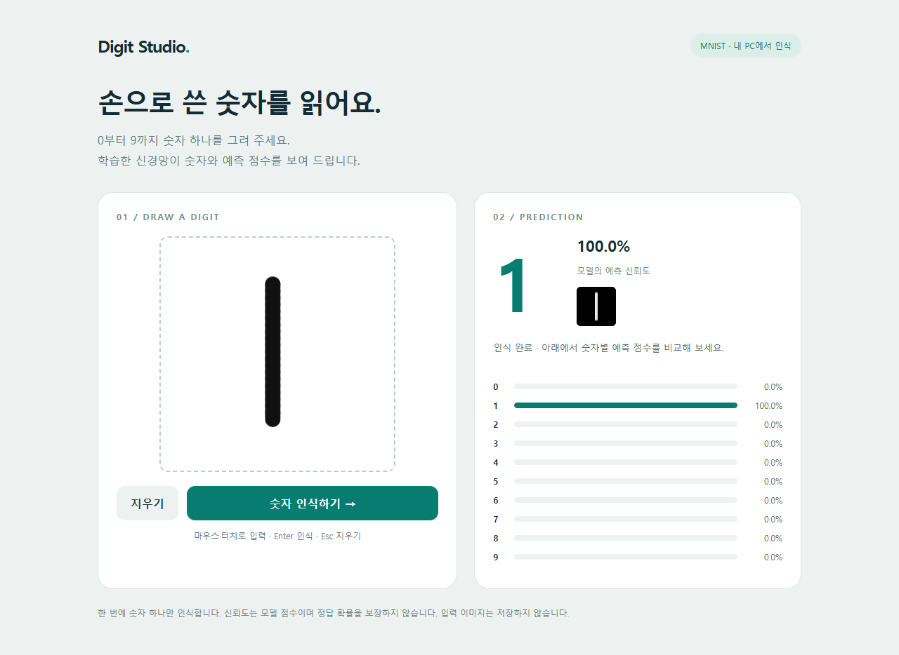

# Digit Studio

[한국어](./README.md) | **English**

Digit Studio is a Python project that recognizes a single digit drawn with the mouse. The web interface and the Tkinter desktop app share a neural network trained on MNIST.



## Features

- Draw, recognize, and clear a single digit from 0 to 9.
- See the predicted digit and the model's confidence.
- View scores for each digit and the preprocessed 28×28 image in the web interface.
- Press Enter to recognize the digit or Esc to clear the canvas.
- Run inference locally with trained weights. The app neither stores nor sends input images.

## Run on Windows

Python 3.11 or later is recommended. Select **Add python.exe to PATH** during installation and include Tcl/Tk if you plan to use the desktop app.

1. Clone the repository or download the ZIP and extract all of its contents.
2. Run **start_web.bat** for the web version or **start_desktop.bat** for the desktop version.
3. The first launch creates a dedicated virtual environment and installs NumPy and Pillow.

The web version opens your browser automatically. If it does not, visit the `http://127.0.0.1:port` address shown in the terminal. Keep the terminal open while using the app, then press Ctrl+C to stop it. Recognition requires the local server, so opening `index.html` directly will not work.

The first package installation requires an internet connection. After setup, recognition runs without internet access, an API key, or a GPU. The batch files launch Python and require it to be installed.

### Run from a terminal

Run these commands from the project folder in Windows PowerShell.

```powershell
py -3 -m venv .venv
.\.venv\Scripts\python.exe -m pip install -r requirements.txt
.\.venv\Scripts\python.exe web_version/server.py
```

For the desktop app, replace the last command with this one.

```powershell
.\.venv\Scripts\python.exe desktop_version/app.py
```

On macOS and Linux, create the environment with `python3 -m venv .venv` and use `.venv/bin/python`. The desktop version also needs Tkinter and a graphical display.

## How recognition works

1. Convert the digit drawn on a white background to grayscale and invert the image.
2. Crop to the area containing the digit and resize its longest side to 20 pixels.
3. Place it in a 28×28 image and align its center of mass with the image center.
4. Normalize pixel values to the range 0–1 and feed the image to a `784 → 128 → 64 → 10` multilayer perceptron.
5. Display the digit with the highest softmax score.

Training uses scikit-learn and inference uses NumPy. The two interfaces share the preprocessing and inference code in `shared/engine.py` and load weights from `model.npz` without pickle. The web server listens only on `127.0.0.1`.

## Verification

The automated tests run without additional test packages or data downloads.

```powershell
.\.venv\Scripts\python.exe -m unittest discover -s tests -v
```

- 13 automated tests cover preprocessing, blank input, digit recognition, HTTP responses, malformed JSON, and invalid image formats, among other cases.
- The tests passed on Windows in an existing Python 3.9.13 environment and a new Python 3.14 virtual environment.
- Browser checks covered blank-input feedback, mouse drawing, recognition, and clearing.
- Windows Tkinter checks covered recognition and resetting the canvas and result.
- GitHub Actions runs the automated tests on Windows and Linux with Python 3.11 and 3.14.

Re-evaluation of the included model on all 10,000 MNIST test images yielded **97.7% accuracy (9,770/10,000)**. In a separate check, the first 1,000 images were enlarged to 336×336 using nearest-neighbor resizing and passed through the drawing canvas preprocessing. That check yielded **96.8% accuracy (968/1,000)**. These figures do not measure accuracy on digits drawn by actual users.

The app supports a single digit only. It cannot recognize Hangul, Latin letters, or multi-digit numbers. Confidence is the model's softmax score and is uncalibrated. Recognition can vary with handwriting.

## Retrain the model

```powershell
.\.venv\Scripts\python.exe -m pip install -r requirements-train.txt
.\.venv\Scripts\python.exe train_model.py
```

The first training run downloads the [MNIST dataset](https://storage.googleapis.com/tensorflow/tf-keras-datasets/mnist.npz) to `data/mnist.npz`. Training reserves 10% of the 60,000 training images for early-stopping validation and uses the 10,000 test images for final evaluation. Close the app before training and restart it afterward.

Retraining updates `model.npz` and `model_metrics.json`. To use an existing MNIST file, specify it with `--data path`. Virtual environments and downloaded data are excluded from Git.

## Files

```text
desktop_version/app.py  Tkinter interface
web_version/server.py   Local HTTP server
web_version/index.html  Web interface and canvas input
shared/engine.py        Shared preprocessing and inference
tests/test_app.py       Automated tests
train_model.py          MNIST training and weight export
model.npz               Trained weights
model_metrics.json      Evaluation metrics recorded during training
launch.bat              Windows virtual environment setup and launcher
start_web.bat           Web version launcher
start_desktop.bat       Desktop version launcher
```

## Learning exercises

- Compare how resizing and centering during preprocessing affect recognition.
- Trace how the web and desktop interfaces reuse the same logic.
- Follow NumPy-only inference without the library used for training.
- Write tests that reproduce invalid input and improve how the app handles it.
