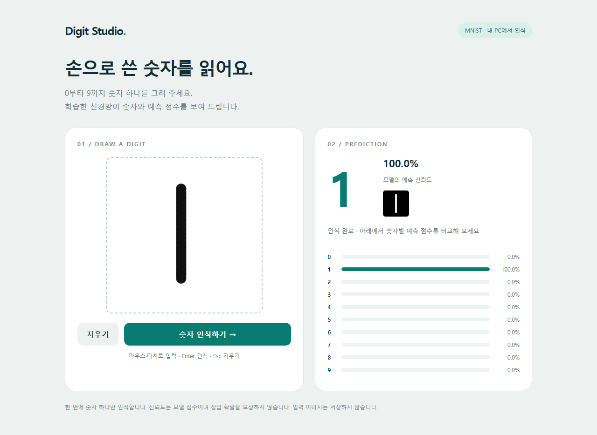

# Digit Studio

**한국어** | [English](./README.en.md)

마우스로 쓴 숫자 하나를 인식하는 Python 프로젝트입니다. MNIST로 학습한 신경망을 웹 화면과 Tkinter 데스크톱 앱에서 함께 사용합니다.



## 주요 기능

- 0~9 숫자 한 개 그리기, 인식, 지우기
- 예측 숫자와 모델 신뢰도 표시
- 웹 화면에서 숫자별 점수와 전처리된 28×28 이미지 확인
- Enter로 인식, Esc로 지우기
- 학습된 가중치를 이용한 로컬 추론: 입력 이미지를 저장하거나 외부로 전송하지 않음

## Windows에서 실행

Python 3.11 이상을 권장합니다. 설치할 때 **Add python.exe to PATH**를 선택하고, 데스크톱 앱을 사용할 경우 Tcl/Tk도 설치합니다.

1. 저장소를 복제하거나 ZIP을 내려받아 모두 압축 해제합니다.
2. 웹 버전은 **start_web.bat**, 데스크톱 버전은 **start_desktop.bat**을 실행합니다.
3. 첫 실행 시 전용 가상환경을 만들고 NumPy와 Pillow를 설치합니다.

웹 버전은 브라우저가 자동으로 열립니다. 열리지 않으면 실행 창에 표시된 `http://127.0.0.1:포트` 주소로 접속합니다. 실행 창을 유지하고, 종료할 때는 Ctrl+C를 누릅니다. `index.html`을 직접 열면 인식 기능을 사용할 수 없습니다.

첫 패키지 설치에는 인터넷 연결이 필요합니다. 이후 인식에는 인터넷, API 키, GPU가 필요하지 않습니다. 배치 파일은 Python 실행 도우미이며 독립 실행 파일은 아닙니다.

### 터미널에서 실행

프로젝트 폴더에서 다음 명령을 실행합니다. Windows PowerShell 기준입니다.

```powershell
py -3 -m venv .venv
.\.venv\Scripts\python.exe -m pip install -r requirements.txt
.\.venv\Scripts\python.exe web_version/server.py
```

데스크톱 앱은 마지막 명령 대신 아래 명령을 실행합니다.

```powershell
.\.venv\Scripts\python.exe desktop_version/app.py
```

macOS와 Linux에서는 `python3 -m venv .venv`로 환경을 만들고 `.venv/bin/python`을 사용합니다. 데스크톱 버전은 Tkinter 설치와 그래픽 화면이 필요합니다.

## 인식 과정

1. 흰 배경에 그린 숫자를 회색조로 변환하고 배경을 반전합니다.
2. 숫자가 있는 영역만 잘라 긴 변이 20픽셀이 되도록 축소합니다.
3. 28×28 이미지 중앙에 놓고 무게중심을 맞춥니다.
4. 픽셀 값을 0~1로 정규화한 뒤 `784 → 128 → 64 → 10` 구조의 MLP에 입력합니다.
5. softmax 점수가 가장 높은 숫자를 결과로 표시합니다.

학습은 scikit-learn, 추론은 NumPy를 사용합니다. 가중치는 pickle 없이 `model.npz`에서 읽으며, 두 화면은 `shared/engine.py`의 전처리와 추론을 공유합니다. 웹 서버는 `127.0.0.1`에서만 실행합니다.

## 검증

자동 테스트는 별도 테스트 패키지나 데이터 다운로드 없이 실행할 수 있습니다.

```powershell
.\.venv\Scripts\python.exe -m unittest discover -s tests -v
```

- 자동 테스트 13개: 전처리, 빈 입력 거부, 숫자 인식, HTTP 응답, 잘못된 JSON·이미지 형식 처리 등
- Windows의 Python 3.9.13 기존 환경과 Python 3.14 새 가상환경에서 테스트 통과
- 브라우저에서 빈 입력 안내, 마우스 그리기, 인식, 지우기 동작 확인
- Windows Tkinter 앱의 인식 및 캔버스·결과 초기화 확인
- GitHub Actions에서 Windows/Linux, Python 3.11/3.14 조합으로 자동 테스트 실행

포함된 모델을 MNIST 테스트 이미지 10,000장으로 다시 평가한 정확도는 **97.7% (9,770/10,000)**입니다. 첫 1,000장을 336×336으로 최근접 확대하고 그림판 전처리를 적용한 별도 점검에서는 **96.8% (968/1,000)**였습니다. 이 수치는 실제 사용자가 그린 숫자의 인식률을 의미하지 않습니다.

한글, 영문, 여러 자리 숫자는 지원하지 않습니다. 신뢰도는 모델의 softmax 점수이며 보정된 정답 확률이 아닙니다. 필체에 따라 오인식할 수 있습니다.

## 다시 학습하기

```powershell
.\.venv\Scripts\python.exe -m pip install -r requirements-train.txt
.\.venv\Scripts\python.exe train_model.py
```

첫 학습 시 [MNIST 데이터](https://storage.googleapis.com/tensorflow/tf-keras-datasets/mnist.npz)를 `data/mnist.npz`에 내려받습니다. 학습 이미지 60,000장 중 10%를 조기 종료용 검증에 사용하며, 테스트 이미지 10,000장으로 최종 평가합니다. 실행 중인 앱을 종료한 후 학습하고 다시 실행합니다.

재학습하면 `model.npz`와 `model_metrics.json`이 갱신됩니다. `--data 경로`로 기존 MNIST 파일을 지정할 수도 있습니다. 가상환경과 다운로드한 데이터는 Git 관리에서 제외합니다.

## 파일 구성

```text
desktop_version/app.py  Tkinter 화면
web_version/server.py   로컬 HTTP 서버
web_version/index.html  웹 화면과 캔버스 입력
shared/engine.py        공통 전처리 및 추론
tests/test_app.py       자동 테스트
train_model.py         MNIST 학습과 가중치 내보내기
model.npz              학습된 가중치
model_metrics.json     학습 시 측정한 평가 결과
launch.bat             Windows 가상환경 설정 및 실행
start_web.bat          웹 실행 바로가기
start_desktop.bat      데스크톱 실행 바로가기
```

## 학습해 볼 내용

- 전처리의 크기·중앙 정렬 방식이 인식 결과에 미치는 영향 비교
- 웹과 데스크톱 화면에서 공통 로직을 재사용하는 구조 살펴보기
- 학습 시 사용한 라이브러리 없이 NumPy만으로 추론하는 과정 이해하기
- 잘못된 입력을 재현하는 테스트를 작성하고 처리 로직 수정하기
